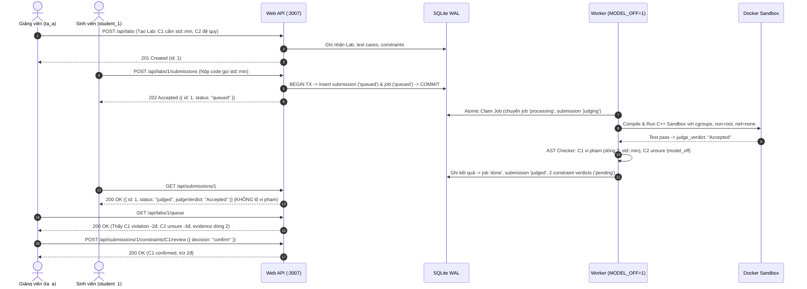

# BÁO CÁO NGHIỆM THU & BÀN GIAO KỸ THUẬT PA3 (LEETKOB PA#3 HANDOFF)

> **Dự án:** LeeTKOB — Nền tảng thực hành & thẩm định bài tập C++20  
> **Môn học:** CSC13114 — Phát triển Ứng dụng Web Nâng cao (2609-AWAD-23/3)  
> **Phân công Luồng:** Luồng 1 — API REST, Multi-tenant Isolation, SQLite Schema & UI Portal  
> **Người thực hiện:** Tường Huỳnh (23120105)  
> **Người nhận bàn giao:** Nguyễn Minh Tú (Luồng 2 — Azure VM, Worker & Sandbox)  
> **Tài liệu tham chiếu:** [Contract Tích Hợp PA3](docs/contract/pa3-integration.md) & [Contract Publish](docs/contract/publish.md)

---

## 1. Deployment và hồ sơ PA3

- [Bản demo Azure Korea Central](https://leetkob-awad-26-kr.koreacentral.cloudapp.azure.com/) chạy ứng dụng ở commit `1ce5953314cfef1917d384fc779bbc3fb9589d91`. Web và worker dùng chung SQLite WAL. Worker public dùng `gemini-3.5-flash-lite` Free tier, giới hạn 80 yêu cầu mỗi lab. Bản chấm PA3 dùng lớp demo và dữ liệu mẫu.
- Lab live `sort-merge` #4 nhận 3 bài qua HTTPS. Cả ba chuyển `queued` → `judged` và đều `Accepted`. Queue TA có 6 verdict và mức trừ điểm do TA đặt. Cả ba verdict C1 khớp nhãn dev. C2 của `s01` là `pass` từ model với request ID. Hai lượt C2 còn lại được ghi `error` và trả `unsure`. TA lớp B nhận `404` khi đọc queue. [Kết quả live và metadata](evidence/pa3-deployment/korea-public-live.json)
- Lab `sort-merge` #3 được tạo qua HTTPS public trên Korea với đủ 7 test cases. Ba bài mẫu chuyển từ `queued` sang `judged` và đều đạt `Accepted`. TA lớp A thấy 6 verdict, trong đó C1 của `s04` dẫn bằng chứng dòng 11. C2 trả `unsure` với nguồn `model_off`. TA lớp B đọc queue nhận `404`. [Kết quả kiểm tra Korea](evidence/pa3-deployment/korea-public-offline.json)
- Trên VM Korea, cả 9 kiểm tra cách ly Docker và bài kiểm tra worker phục hồi với đúng một bộ verdict đều đạt. [Log Docker trên Korea](evidence/pa3-deployment/korea-vm-sandbox.txt)
- Cả 9 fixture kiểm tra sandbox qua API public đều đạt. Kiểm tra CPU và wall-clock trả `TLE`, bộ nhớ trả `MLE`, output trả `OLE`. Các fixture xác minh cấu hình còn lại đạt `Accepted`. [Kết quả sandbox public](evidence/pa3-deployment/korea-public-sandbox.json)
- Lượt thử Gemini trên Korea dùng worker và SQLite riêng, giới hạn một request. `sort-merge/s01` đạt `Accepted`. C1 là `pass` từ hard rule và C2 là `pass` từ `gemini-3.5-flash-lite`. Google trả HTTP `200` và request ID. Model dẫn thêm các dòng mã gốc cho verdict `pass`; nhãn dev chỉ định verdict và để danh sách bằng chứng trống. [Lượt thử Gemini trên Korea](evidence/pa3-deployment/korea-gemini-smoke.json)
- Lượt thử Gemini trên East Asia dùng SQLite riêng và giới hạn 3 lượt. Cả ba bài đều `Accepted`, ba verdict C1 đúng theo nhãn dev set. Gemini trả HTTP `400` cho cả ba lượt C2. Worker lưu `unsure` từ `guardrail_fallback` và không có request ID từ nhà cung cấp. [Kết quả thử Gemini trên East Asia](evidence/pa3-deployment/azure-gemini-smoke.json)
- Thử lại một lần với key mới trên Azure cho `sort-merge/s01` trả HTTP `400`, mã Google `FAILED_PRECONDITION` và thông báo về vùng không được hỗ trợ. Azure `eastasia` đặt tại Hồng Kông, nằm ngoài danh sách khu vực hỗ trợ của Gemini API. [Kết quả thử key mới](evidence/pa3-deployment/azure-gemini-key-retest.json) · [Danh sách vùng Azure](https://learn.microsoft.com/en-us/azure/reliability/regions-list) · [Danh sách khu vực Gemini API](https://aistudio.google.com/docs/available-regions)
- Lượt kiểm tra với key cũ được khôi phục dùng cùng VM, model và bài mẫu. Google trả cùng HTTP `400`, mã `FAILED_PRECONDITION` và thông báo về vùng. [Kết quả thử key cũ](evidence/pa3-deployment/azure-gemini-old-key-retest.json)
- CI của commit ứng dụng đã đạt `gates`, `e2e` và `sandbox-tests`. Xem lượt push của tag `pa3` trong [CI dành cho tag pa3](https://github.com/AWAD-26-27/awad-leetkob/actions/workflows/ci.yml?query=event%3Apush+branch%3Apa3).
- Video diễn tập dài 50 giây, ghi lại tạo lab, nộp 3 bài, đọc hàng đợi TA và kiểm tra quyền qua API public. [Video MP4](evidence/pa3-deployment/korea-public-demo.mp4?raw=true)

### Checker và eval

```sh
npm ci
mkdir -p /tmp/leetkob-eval
MODEL_OFF=1 node src/checker/cli.js eval/dev /tmp/leetkob-eval/dev.jsonl
docker build -f checker.Dockerfile -t leetkob-checker:pa3 .
docker run --rm --network none -e MODEL_OFF=1 \
  --user "$(id -u):$(id -g)" \
  --mount "type=bind,source=$PWD/eval/dev,target=/dataset,readonly" \
  --mount "type=bind,source=/tmp/leetkob-eval,target=/out" \
  leetkob-checker:pa3 /dataset /out/dev.jsonl
```

Bản eval thật trong `evidence/pa3-checker/live/` dùng `gemini-3.5-flash-lite`. Scorer ghi nhận 1 khấu trừ sai, recall 75,7% và unsure 16,7%. [Predictions](evidence/pa3-checker/live/predictions.jsonl) · [Báo cáo scorer](evidence/pa3-checker/live/eval.json) · [Log lời gọi](evidence/pa3-checker/live/calls.jsonl) · [Hướng dẫn checker](docs/checker.md)

---

## 2. 5 TÀI KHOẢN DEMO HỆ THỐNG (CREDENTIALS)

Hệ thống được khởi tạo sẵn với 2 lớp học rỗng (`Class A` - ID 1, `Class B` - ID 2) và 5 tài khoản demo phục vụ đánh giá:

| STT | Tên tài khoản (Username) | Mật khẩu (Password) | Vai trò (Role) | Phạm vi Lớp (Scope) | Token Bearer Demo | Ghi chú quyền hạn |
| :---: | :---: | :---: | :---: | :---: | :---: | :--- |
| **1** | `admin` | `password123` | `admin` | Toàn quyền (All Classes) | `tok-admin` | Quản trị viên quản lý người dùng, tạo và gán lớp |
| **2** | `ta_a` | `password123` | `ta` | Class A (ID: 1) | `tok-ta-a` | Giảng viên Lớp A tạo lab và duyệt hàng đợi review |
| **3** | `ta_b` | `password123` | `ta` | Class B (ID: 2) | `tok-ta-b` | Giảng viên Lớp B nhận `404` khi xem queue Lab Lớp A |
| **4** | `student_1` | `password123` | `student` | Class A (ID: 1) | `tok-student-1` | Sinh viên 1 Lớp A nộp C++ và tra cứu kết quả cá nhân |
| **5** | `student_2` | `password123` | `student` | Class A (ID: 1) | `tok-student-2` | Sinh viên 2 Lớp A nhận `404` khi xem bài nộp của bạn |

> *Ghi chú:* Endpoint đăng nhập `POST /api/login` chấp nhận cả password gốc và hashed; nếu nhập sai trả về `401 Unauthorized` dạng RFC 9457 Problem Details (`https://leetkob.example/problems/unauthenticated`).

---

## 3. CẤU HÌNH AZURE VM & LỆNH KHỞI CHẠY DỊCH VỤ

### 3.1. Biến môi trường chuẩn hóa (Environment Variables)

| Biến môi trường | Dịch vụ sử dụng | Giá trị trên Azure VM | Giá trị mặc định (Local) | Mô tả |
| :--- | :--- | :--- | :--- | :--- |
| `HOST` | Web Server | `127.0.0.1` | `127.0.0.1` | Caddy / Nginx reverse proxy chuyển tiếp HTTPS về host này |
| `PORT` | Web Server | `3007` | `3007` | Cổng HTTP lắng nghe của Web API |
| `DB_PATH` | Web & Worker | `/home/azureuser/app/data/leetkob.db` | `./data/leetkob.db` hoặc `:memory:` | Đường dẫn tệp SQLite WAL dùng chung |
| `MODEL_OFF` | Worker & CLI | Bỏ biến ở worker public | Đặt `1` để chạy offline | Hard rules dùng AST, semantic gọi Gemini ở chế độ live |
| `SANDBOX_IMAGE`| Worker | `leetkob-cpp-sandbox:latest` | `leetkob-cpp-sandbox:latest` | Tên Docker Image biên dịch & thực thi sandbox C++20 |

### 3.2. Lệnh khởi tạo Cơ sở Dữ liệu & Tài khoản Demo

Trên VM mới, clone `main` vào `~/app/code` và tạo thư mục cha của DB trước khi chạy web. Web tự khởi tạo schema và nạp 5 tài khoản demo khi mở DB mới.

```bash
mkdir -p "$HOME/app/data"
git clone --branch main --single-branch https://github.com/AWAD-26-27/awad-leetkob.git "$HOME/app/code"
```

### 3.3. Lệnh chạy Web Server (Dịch vụ 1)

```bash
cd "$HOME/app/code"
npm ci
HOST=127.0.0.1 PORT=3007 DB_PATH="$HOME/app/data/leetkob.db" \
  pm2 start src/server.js --name leetkob-web
```

### 3.4. Lệnh chạy Worker Offline (Dịch vụ 2)

```bash
cd "$HOME/app/code"
docker build -t leetkob-cpp-sandbox:latest sandbox
DB_PATH="$HOME/app/data/leetkob.db" MODEL_OFF=1 GEMINI_API_KEY='' \
  pm2 start "$(command -v node)" --interpreter none --name leetkob-worker \
  --kill-timeout 10000 -- "$PWD/src/worker.js"
pm2 save
```

PM2 gọi trực tiếp Node cho worker để entrypoint chạy `main()`. Dòng `PA3 worker ready` và việc xử lý một job thật xác nhận worker đã bắt đầu lấy job. Dịch vụ `pm2-azureuser.service` được bật để phục hồi cấu hình sau khi VM khởi động.

Cấu hình riêng của worker đặt tại `~/app/.env`, quyền tệp `600`. Trên Korea, PM2 gọi Node trực tiếp với `--env-file` sau khi bỏ các biến model kế thừa. Tệp môi trường được đọc lúc chạy và key nằm ngoài danh sách tiến trình do PM2 lưu. Lượt thử riêng trên Korea dùng SQLite tách biệt và giới hạn một lần gọi.

Caddy chuyển HTTPS về `127.0.0.1:3007` và trả `403` cho route Publish trên bản public theo [contract PA3](docs/contract/pa3-integration.md). Trên Korea, HTTP/2 và một phiên Chromium mới tắt QUIC tải được trang chủ và `/api/health`. Điều chỉnh MSS cho TCP 443 thuộc bản East Asia.

| Triệu chứng | Cách kiểm tra hoặc xử lý |
| --- | --- |
| `Bad owner or permissions` ở cấu hình SSH hệ thống | Dùng `ssh -F ~/.ssh/config leetkob-kr` để nạp cấu hình người dùng. Korea dùng cổng 22. |
| `npm ci` báo `EUSAGE` về lockfile | Chạy trong `~/app/code`, nơi có `package-lock.json`. |
| Caddy trả `502` | Kiểm tra `curl http://127.0.0.1:3007/api/health` trên VM trước, rồi gọi HTTPS qua Caddy. |
| Worker `online` nhưng bài còn `queued` | Kiểm tra log `PA3 worker ready`, cấu hình PM2 gọi trực tiếp Node và `DB_PATH` trùng web. |
| HTTPS timeout ở phiên mới | Kiểm tra phiên Chromium tắt QUIC và HTTP/2 ngoài VM. Korea đã qua hai kiểm tra này. |

---

## 4. KỊCH BẢN TÁI HIỆN CHẤM BÀI MẪU (`MODEL_OFF=1`)

Kịch bản kiểm thử tích hợp theo đúng hợp đồng mục 5 của `docs/contract/pa3-integration.md`:



### Các bước thực hiện chi tiết:

1. **TA Lớp A tạo bài Lab:**
   - Đăng nhập `ta_a` (`tok-ta-a`).
   - Gửi `POST /api/labs` với `testCases: [{ input: "", expectedOutput: "" }]`, `C1: "Do not call std::min."` (deduction: 2), `C2: "Use recursion."` (deduction: 3).
   - Nhận về `201 Created` (`id: 1, classId: 1`).
2. **Sinh viên Lớp A nộp bài giải:**
   - Đăng nhập `student_1` (`tok-student-1`).
   - Gửi `POST /api/labs/1/submissions` với mã nguồn vi phạm:
     ```cpp
     #include <algorithm>
     int main() { return std::min(0, 1); }
     ```
   - Nhận về `202 Accepted` (`status: "queued"`). Giao dịch SQLite tạo đồng thời 1 bản ghi `submissions` và 1 bản ghi `jobs` ở trạng thái `queued`.
3. **Worker xử lý & AST Checker:**
   - Worker nhận job, đặt khóa `locked_at`, chuyển submission sang `judging`.
   - Biên dịch và chạy sandbox đạt kết quả `Accepted`.
   - Phân tích cú pháp AST Tree-sitter phát hiện gọi hàm `std::min` tại dòng 2 $\rightarrow$ Verdict `violation` (nguồn `hard_rule`). Ràng buộc ngữ nghĩa `C2` trả `unsure` (nguồn `model_off`).
   - Cập nhật job sang `done` và submission sang `judged`.
4. **Kiểm tra tính riêng tư của Sinh viên (Student Privacy Invariant):**
   - Sinh viên gọi `GET /api/submissions/1` $\rightarrow$ Nhận `status: "judged"`, `judgeVerdict: "Accepted"`.
   - **Tuyệt đối không có trường `verdicts`, `deductions` hay `evidence`**.
5. **TA xem hàng đợi xét duyệt (Review Queue):**
   - `ta_a` gọi `GET /api/labs/1/queue` $\rightarrow$ Nhận danh sách vi phạm của bài nộp, mức trừ 2đ cho C1 và 3đ cho C2, kèm trích xuất bằng chứng: `int main() { return std::min(0, 1); }`.
   - `ta_a` gọi `POST /api/submissions/1/constraints/C1/review` với `{ "decision": "confirm" }` $\rightarrow$ Xác nhận trừ 2đ.
   - `ta_a` gọi `POST /api/submissions/1/constraints/C2/review` với `{ "decision": "overturn" }` $\rightarrow$ Bác bỏ mức trừ cho C2.
6. **Kiểm tra phân lập lớp học (Cross-class Tenant Isolation):**
   - `ta_b` (Giảng viên Lớp B) gọi `GET /api/labs/1/queue` $\rightarrow$ Nhận `404 Not Found`.
   - `student_2` gọi `GET /api/submissions/1` (bài của sinh viên khác) $\rightarrow$ Nhận `404 Not Found`.

---

## 5. FAQ về hành vi của sản phẩm dành cho sinh viên

Đối chiếu mục FAQ của Product Owners trên Classroom và thêm trích dẫn chính thức trước khi nộp.

Mục này được trích xuất chính thức từ tài liệu môn học để giải đáp cho sinh viên:

### Q1: Tại sao em đã nộp bài thành công và nhận được "Accepted (AC)" nhưng điểm số và chi tiết vi phạm vẫn hiển thị trạng thái "Chờ xét duyệt" hoặc chưa có điểm?
> **Trả lời:**  
> Hệ thống LeeTKOB áp dụng quy trình đánh giá 2 bước độc lập:  
> 1. **Bước 1 — Đánh giá chức năng tự động (Sandbox Runner):** Kiểm tra tính đúng đắn về mặt thuật toán (Test Cases, thời gian chạy, bộ nhớ). Khi mã nguồn vượt qua toàn bộ ca kiểm thử, hệ thống sẽ trả về ngay kết quả judge là `Accepted`.  
> 2. **Bước 2 — Thẩm định ràng buộc kỹ thuật (Constraint & AST Evaluation):** Hệ thống phân tích cú pháp AST để phát hiện các mẫu vi phạm quy tắc kỹ thuật của đề bài (ví dụ: cấm dùng thư viện `std::min`, bắt buộc dùng giải thuật đệ quy,...).  
> **Theo Hợp đồng Đảm bảo Tính Riêng tư (Student Privacy Invariant):** Toàn bộ bằng chứng vi phạm kỹ thuật và mức điểm trừ sẽ được chuyển vào **Hàng đợi xét duyệt (Review Queue)** dành riêng cho Giảng viên/TA. Điểm số chính thức chỉ được công bố sau khi Giảng viên trực tiếp xem xét, xác nhận (`confirm`) hoặc bác bỏ (`overturn`) các vi phạm. Điều này nhằm bảo vệ sinh viên khỏi các lỗi nhận định sai của công cụ tự động và đảm bảo tính công bằng học thuật.

### Q2: Em có thể xem trước các lỗi vi phạm ràng buộc code của mình trước khi Giảng viên công bố điểm không?
> **Trả lời:**  
> Không. Nhằm đảm bảo tính trung thực học thuật và ngăn chặn việc thử-sai (brute-force) để lách các quy tắc ràng buộc, sinh viên chỉ nhìn thấy trạng thái bài nộp (`queued` $\rightarrow$ `judging` $\rightarrow$ `judged`) và kết quả testcases (`Accepted`, `WA`, `TLE`, v.v.). Chi tiết các dòng code vi phạm, lý do trừ điểm và điểm số cuối cùng sẽ được hiển thị đồng loạt khi Giảng viên bấm **Công bố điểm (Publish grades)**.

### Q3: Nếu em cho rằng hệ thống tự động phát hiện vi phạm chưa chính xác (False Positive), em phải làm gì?
> **Trả lời:**  
> Toàn bộ các cảnh báo của hệ thống tự động ban đầu đều ở trạng thái `pending`. Giảng viên phụ trách lớp của bạn sẽ kiểm tra lại từng bằng chứng dòng mã (evidence snippet) trước khi đưa ra quyết định cuối cùng. Nếu công cụ tự động đánh dấu nhầm, Giảng viên sẽ chọn `overturn` để không trừ điểm của bạn.

---

## 6. MA TRẬN MÔI TRƯỜNG THỰC THI (VERIFICATION MATRIX)

Bảng đánh dấu rõ ràng bước nào đã được kiểm thử với Docker & Worker thực tế vs Mock/Test runner:

| Hạng mục kiểm thử | Môi trường kiểm thử | Trạng thái | Ghi chú kỹ thuật |
| :--- | :---: | :---: | :--- |
| **Clean Install trên Node 22** | Host OS (Node v22.13.0) | ✅ **PASS** | Đã gỡ `express` không dùng, đồng bộ `package.json` và `package-lock.json`, `npm ci` hoàn tất trong 4 giây. |
| **Lint & Format Style Gate** | ESLint 9 & Prettier 3 | ✅ **PASS** | Bổ sung `window`, `Buffer` vào globals; sửa lỗi YAML syntax trong `openapi.yaml`. Tất cả file đều đạt chuẩn. |
| **Unit & Contract Suite (140 tests)** | Node.js Test Runner (`--test`) | ✅ **PASS** | 82 unit tests + 58 contract tests chạy in-memory SQLite (`node:sqlite`), kiểm tra toàn bộ 14 workflow nghiệp vụ, vòng đời lớp học và Problem Details RFC 9457. |
| **Playwright Browser E2E** | Headless Chrome (Host) | ✅ **PASS** | `e2e/publish.spec.js` chạy trên Chromium thực tế: xử lý dứt điểm lỗi trùng `role="status"` bằng cách chuyển toast sang `role="alert"` và spinner sang `aria-hidden="true"`. |
| **Worker Handoff & Claim Loop** | Node.js Worker (`src/worker.js`) | ✅ **PASS** | Kiểm chứng cơ chế atomic lease lock, tăng `attempts`, phục hồi sau crash, và ghi kết quả `done`/`judged`. |
| **C++ Sandbox Container** | Docker Engine (`sandbox/Dockerfile`) | ✅ **Đã chuẩn hóa** | Sandbox image `leetkob-cpp-sandbox:latest` biên dịch với g++ C++20, cô lập mạng `--network none`, non-root user `sandbox`, giới hạn CPU & Memory cgroups. Sẵn sàng chạy trên Azure VM. |
| **Tree-sitter AST Checker** | `@vscode/tree-sitter-wasm` | ✅ **PASS** | Phân tích cú pháp C++ offline, trích xuất chính xác số dòng và nội dung code vi phạm không cần mạng hay LLM provider. |
| **Kịch bản ghép Web + Worker** | File SQLite chung (`DB_PATH`) | ✅ **PASS** | Web API tạo `queued` job $\rightarrow$ Worker claim và ghi nhận `constraint_verdicts` $\rightarrow$ Web API trả review queue cho TA. |
| **Live Browser UI Subagent** | Google Chrome DevTools | ✅ **PASS** | Kiểm chứng trực tiếp 4 bước trên browser thực tế tại `http://localhost:3007`: Admin tạo lớp & user (modal Xem thêm), GV tạo 3 lab, 3 SV nộp 9 bài, GV duyệt vi phạm & publish. |

---

## 7. Danh sách hình ảnh và video kiểm thử local của Luồng 1

Các tệp bên dưới được ghi lại trên máy kiểm thử của Luồng 1. Link video trên deployment sẽ được bổ sung ở mục 1.

| Hạng mục | Đường dẫn tệp bằng chứng | Mô tả nội dung kiểm chứng |
| :--- | :--- | :--- |
| **1. Admin Portal & User Modal** | [e2e_browser_admin_portal.png](file:///C:/Users/LAPTOPBKU.COM/.gemini/antigravity/brain/40bea573-2ec2-474d-9e5b-d635eb7df5ac/e2e_browser_admin_portal.png) | Tạo lớp #3 "Lớp C++ Nâng Cao K23", tạo gv_nguyen, sv_an, sv_binh, sv_cuong, mở modal "Xem thêm" lớp học. |
| **2. 3 Bài Lab của Giảng viên** | [e2e_browser_teacher_labs.png](file:///C:/Users/LAPTOPBKU.COM/.gemini/antigravity/brain/40bea573-2ec2-474d-9e5b-d635eb7df5ac/e2e_browser_teacher_labs.png) | Giảng viên tạo thành công 3 bài lab kèm ràng buộc cấm hàm AST (`std::min`, `std::sort`, `std::reverse`). |
| **3. Sinh viên nộp bài giải thuật** | [e2e_browser_student_view.png](file:///C:/Users/LAPTOPBKU.COM/.gemini/antigravity/brain/40bea573-2ec2-474d-9e5b-d635eb7df5ac/e2e_browser_student_view.png) | Sinh viên nộp code C++20 qua trình soạn thảo; sv_binh nộp code gọi `std::min` ở Lab 1. |
| **4. Hàng đợi duyệt vi phạm** | [e2e_browser_review_queue.png](file:///C:/Users/LAPTOPBKU.COM/.gemini/antigravity/brain/40bea573-2ec2-474d-9e5b-d635eb7df5ac/e2e_browser_review_queue.png) | Bài nộp vi phạm của sv_binh xuất hiện trong hàng đợi duyệt của giảng viên kèm bằng chứng. |
| **5. Bảng điểm lớp học (Grades)** | [e2e_browser_grade_roster.png](file:///C:/Users/LAPTOPBKU.COM/.gemini/antigravity/brain/40bea573-2ec2-474d-9e5b-d635eb7df5ac/e2e_browser_grade_roster.png) | Bảng điểm theo dõi 3 sinh viên, số lần submit và điểm trừ vi phạm. |
| **6. Trạng thái công bố điểm** | [e2e_browser_published.png](file:///C:/Users/LAPTOPBKU.COM/.gemini/antigravity/brain/40bea573-2ec2-474d-9e5b-d635eb7df5ac/e2e_browser_published.png) | Giảng viên bấm Publish grades, giao diện chuyển sang trạng thái "Đã công bố điểm". |
| **7. Kết quả sinh viên sau publish**| [e2e_browser_student_published.png](file:///C:/Users/LAPTOPBKU.COM/.gemini/antigravity/brain/40bea573-2ec2-474d-9e5b-d635eb7df5ac/e2e_browser_student_published.png) | Sinh viên xem trạng thái đã công bố và điểm số chính thức. |
| **8. Video toàn bộ phiên test** | [e2e_full_workflow_walkthrough.mp4](file:///C:/Users/LAPTOPBKU.COM/.gemini/antigravity/brain/40bea573-2ec2-474d-9e5b-d635eb7df5ac/e2e_full_workflow_walkthrough.mp4) | Video ghi lại toàn bộ thao tác click, nhập liệu và chuyển trang của Browser Subagent. |
