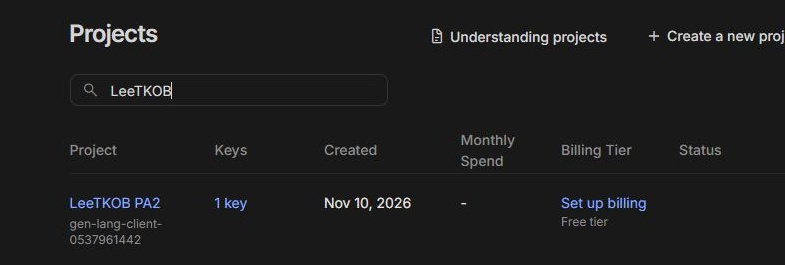

# Model setup and spending boundary

Verified on **10 November 2026**, with the user's explicit approval to create a key and save it locally. No paid subscription, billing account, credits or auto-reload was enabled.

| Item                      | Actual setup                                                                                                |
| ------------------------- | ----------------------------------------------------------------------------------------------------------- |
| Provider/model            | Google Gemini API, `gemini-3.8-flash`                                                                       |
| Dedicated project         | LeeTKOB PA2 (`gen-lang-client-0537961442`)                                                                  |
| Billing                   | Free tier, **no billing account linked**; UI offers `Set up billing`                                        |
| Paid spending limit       | **USD 0**, enforced by keeping this project unlinked from paid billing; no paid fallback                    |
| Key                       | `leetkob-pa2-server`, one server key; value stored only in ignored local `.env`                             |
| Application usage         | Demo, unit/contract tests and CI make no model calls                                                        |
| Current cost per demo lab | **USD 0** (zero calls)                                                                                      |
| Future model-backed lab   | Free-tier tokens cost USD 0 within provider quota; no measured 80-submission lab cost/throughput is claimed |



The image shows a key exists, the project is Free tier and billing is not set up, without revealing any credential or account email. API keys inherit their project's billing state; they do not have separate billing settings. The USD 0 boundary here is **not** a numeric paid-tier spend-cap field or a budget-alert policy. Linking billing would change this boundary and requires explicit authorization and new evidence.

Google's paid project caps are documented as experimental and may overshoot during billing latency; we did not enable that billing mode. The no-billing free-tier setup avoids a paid overage path. Free-tier quotas still limit requests, and provider availability is independent of the spending boundary.

## Reproduce the manual setup check

The project owner provisions a separate key to a developer privately. Store it only in ignored `.env` as `GEMINI_API_KEY` and set `GEMINI_MODEL` to `gemini-3.8-flash`; do not put either value in `.env.example`. Keep optional `PORT`/`CHROME_PATH` unset unless needed. Then run:

```sh
node --env-file=.env scripts/model-smoke.js
```

This check sends only the synthetic instruction `Reply with exactly OK. No other text.` It uses a 30-second timeout and at most 256 generated tokens, prints only successful response/token metadata, and reports HTTP status without provider error bodies. It does not run in `npm run check`, tests or CI. Never include `.env` in a ZIP, a Git commit or evidence screenshots.

The first setup request returned **HTTP 503**; the retry timed out at 30 seconds. A separate read-only model-list request returned **HTTP 200** and included `models/gemini-3.8-flash`, verifying the credential and model access. Details are in [AI-LOG.md](../AI-LOG.md#nam-anh-model-setup). A created key and verified free billing state are not a claim that model inference or LeeTKOB's semantic constraint checker has passed acceptance tests.

## Data and future integration

Free-tier prompts/responses may be used to improve Google's products. Setup uses synthetic text only. Before PA#3 sends real student submissions, the team must approve its data policy; strip comments/identity as the class brief requires, validate evidence and route timeout/invalid output to `unsure`. Hard rules decide first; only remaining semantic constraints go to the model. The TA sets deductions and reviews before Publish.

The provider/model is selected for code reasoning, not validated against the class eval yet. Keep model calls out of unit/contract/CI tests; use fixtures. Add the actual per-lab request/token cap and benchmark when implementing that pipeline, rather than claiming an unimplemented cap in PA#2.

Official sources inspected on 10 November 2026:

- [Billing tiers and project/key inheritance](https://aistudio.google.com/docs/billing#projects-api-keys).
- [Verify billing status: Set up billing means no billing account attached](https://aistudio.google.com/docs/billing#verify-billing).
- [Gemini 3.8 Flash pricing](https://aistudio.google.com/docs/pricing#gemini-3.8-flash): free-tier input/output are free of charge; [captured pricing](../evidence/gemini-pricing-2026-11-10.jpg).
- [Project spend caps and latency limitations](https://aistudio.google.com/docs/billing#project-spend-caps).
